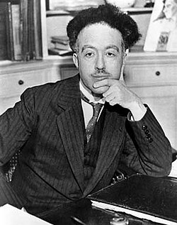

# Prince Louis-Victor Pierre Raymond de Broglie

**Born:** 15 August 1892

**Died / status:** 19 March 1987

**Fields:** Quantum mechanics, Matter waves

For the photographer or artist, date and type of image, consult the original image record.

## Biography

Prince Louis-Victor Pierre Raymond de Broglie was born in Dieppe, France and conducted research in quantum mechanics and matter waves. Nobel records list Sorbonne University, Institut Henri Poincaré as the affiliation at the time of the award. They proposed that matter particles have wave properties. They were awarded the Nobel Prize in Physics in 1929.

## Major contributions to physics

- Proposed that matter particles have wave properties
- Provided a conceptual foundation for wave mechanics and electron diffraction

**Nobel Prize in Physics:** 1929

## Image source and rights

- Source: [Original image record](https://commons.wikimedia.org/wiki/File:Broglie_Big.jpg)
- Creator / attribution: Unknown author
- License or rights statement: Public domain
- Local image: [fd65fc03d5e17bd457cc.jpg](../portraits/fd65fc03d5e17bd457cc.jpg)
- Credit: https://www.physics.umd.edu/courses/Phys420/Spring2002/Parra_Spring2002/HTMPages/whoswho.htm

## Sources

- [Louis de Broglie - Facts](https://www.nobelprize.org/prizes/physics/1929/broglie/facts/)
- [Nobel Prize official laureate API, id 36](https://api.nobelprize.org/2.1/laureate/36)
- [Wikipedia: Louis de Broglie](https://en.wikipedia.org/wiki/Louis_de_Broglie)

Record reviewed: 2026-10-26.
