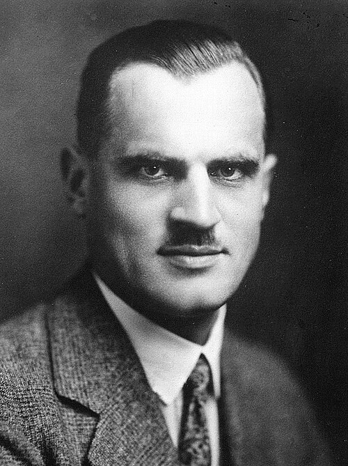

# Arthur Holly Compton

**Born:** 10 September 1892

**Died / status:** 15 March 1962

**Fields:** Quantum physics, X-rays

For the photographer or artist, date and type of image, consult the original image record.

## Biography

Arthur Holly Compton was born in Wooster, OH, USA and conducted research in quantum physics and X-rays. Nobel records list University of Chicago as the affiliation at the time of the award. They discovered the wavelength change of X-rays scattered by electrons, the Compton effect. They were awarded the Nobel Prize in Physics in 1927.

## Major contributions to physics

- Discovered the wavelength change of X-rays scattered by electrons, the Compton effect
- Provided decisive evidence that photons carry both energy and momentum

**Nobel Prize in Physics:** 1927

## Image source and rights

- Source: [Original image record](https://commons.wikimedia.org/wiki/File:Arthur_Compton_1927.jpg)
- Creator / attribution: Unknown (Mondadori Publishers)
- License or rights statement: Public domain
- Local image: [419f839cfa33a0fd1a2b.jpg](../portraits/419f839cfa33a0fd1a2b.jpg)
- Credit: http://www.gettyimages.co.uk/detail/news-photo/portrait-of-the-american-physicist-arthur-compton-x-ray-news-photo/141551127

## Sources

- [Arthur H. Compton - Facts](https://www.nobelprize.org/prizes/physics/1927/compton/facts/)
- [Nobel Prize official laureate API, id 33](https://api.nobelprize.org/2.1/laureate/33)
- [Wikipedia: Arthur Compton](https://en.wikipedia.org/wiki/Arthur_Compton)

Record reviewed: 2026-10-26.
