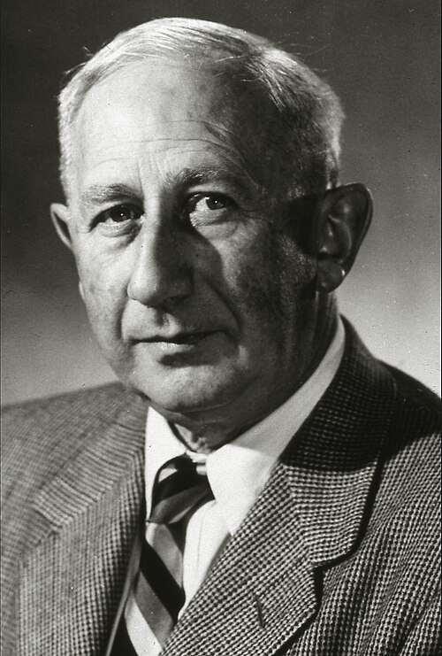

# Walter Baade

**Born:** 24 March 1893

**Died / status:** 25 June 1960

**Fields:** Stellar physics, Observational cosmology

Sourced portrait or photograph; see the image record for provenance and reuse conditions.

## Biography

A German-born observational astronomer, Baade worked in Hamburg and at Mount Wilson and Palomar. Resolving stars in galaxies allowed him to revise stellar populations and the extragalactic distance scale.

## Major contributions to physics

- Distinguished Population I and Population II stars.
- Revised Cepheid calibration and extragalactic distances.
- Connected supernovae with neutron stars with Zwicky.

## Image source and rights

- Source: [Original image record](https://commons.wikimedia.org/wiki/File:Walter-Baade_Astronom.jpg)
- Creator / attribution: Unknown author
- License or rights statement: Public domain
- Local image: [c71412f0db82fd64b02b-ae4b4b42ea.jpg](../portraits/c71412f0db82fd64b02b-ae4b4b42ea.jpg)
- Credit: Mt. Wilson Observatory

## Sources

- [Walter Baade — reference biography (en.wikipedia.org)](https://en.wikipedia.org/wiki/Walter_Baade)

Record reviewed: 2026-10-26.
