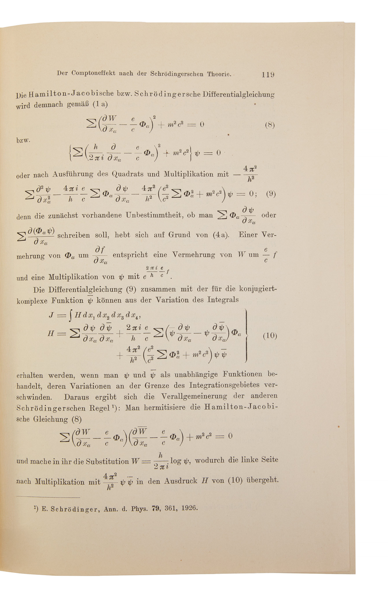

# Walter Gordon

**Born:** 13 August 1893

**Died / status:** 24 December 1939

**Fields:** Quantum mechanics, Relativistic quantum theory

Related documentary illustration, not a portrait. A printed historical portrait is documented in Apoldaer Heimat 14 (1996), p. 39, but a verifiable digital copy remains to be obtained.

## Biography

Gordon was a German theoretical physicist who worked at Hamburg before emigrating to Sweden under Nazi persecution. His research in relativistic quantum theory and mathematics is commemorated in the wave equation now used to describe spin-zero particles.

## Major contributions to physics

- Independently developed the relativistic quantum wave equation now called the Klein–Gordon equation.
- Investigated Compton scattering and relativistic electron theory.

## Historical and source notes

- Sources differ between 3 and 13 August for the birthday. The archive adopts 13 August 1893 from the German Research Foundation historical database.
- A historical portrait is documented in Dieter Ullmann, “Ein Bild des Quantenphysikers Walter Gordon,” Apoldaer Heimat 14 (1996), p. 39. No verifiable digital copy was obtained. The present illustration shows his 1926 offprint and is explicitly not a portrait.

## Image source and rights

- Source: [Original image record](https://grolierclub.omeka.net/items/show/8115)
- Creator / attribution: See the original image record
- License or rights statement: Copyrighted or republication permission unverified; consult the original record
- Local image: [b6338a102b20423b03f9-daf5cfc826.jpg](../portraits/b6338a102b20423b03f9-daf5cfc826.jpg)
- Republication: permission for use on a public website has not been verified. Confirm permission with the rightsholder or replace the image before publication.

## Sources

- [Walter Gordon — biographical or institutional source (www.gepris-historisch.dfg.de)](https://www.gepris-historisch.dfg.de/person/5103898)
- [Walter Gordon — reference biography (en.wikipedia.org)](https://en.wikipedia.org/wiki/Walter_Gordon_%28physicist%29)
- [Walter Gordon — biographical or institutional source (grolierclub.omeka.net)](https://grolierclub.omeka.net/items/show/8115)

Record reviewed: 2026-10-26.
