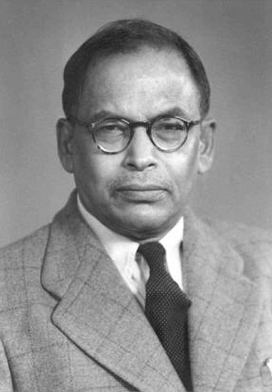

# Meghnad Saha

**Born:** 6 October 1893

**Died / status:** 16 February 1956

**Fields:** Astrophysics, Plasma physics

Sourced photograph or portrait; the image record identifies its creator, provenance, and reuse conditions.

## Biography

An Indian astrophysicist who taught at Allahabad and Calcutta, Saha helped establish nuclear-physics research institutions in India. He connected laboratory atomic physics with stellar spectroscopy and took an active role in scientific planning.

## Major contributions to physics

- Established the Saha equation for ionization equilibria at thermal equilibrium.
- Explained temperature-dependent stellar spectra through ionization balance.

## Image source and rights

- Source: [Original image record](https://commons.wikimedia.org/wiki/File:Dr-Meghnad-Saha.jpg)
- Creator / attribution: Unknown author
- License or rights statement: Public domain
- Local image: [3e9a02fe2888544e3038.jpg](../portraits/3e9a02fe2888544e3038.jpg)
- Credit: http://www.rkmstudentshome.org/our-inspirations/

## Sources

- [Meghnad Saha — reference biography (en.wikipedia.org)](https://en.wikipedia.org/wiki/Meghnad_Saha)

Record reviewed: 2026-10-26.
