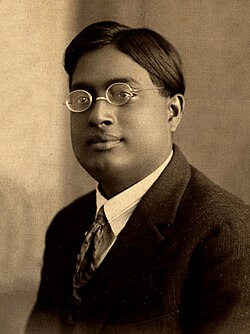

# Satyendra Nath Bose

**Born:** 1 January 1894

**Died / status:** 4 February 1974

**Fields:** Quantum statistics, Theoretical physics

Sourced photograph or portrait; the image record identifies its creator, provenance, and reuse conditions.

## Biography

Bose was an Indian theoretical physicist at Dhaka and Calcutta. In 1924 he sent Einstein a paper on photon statistics, initiating a quantum-statistical method fundamentally different from classical particle counting.

## Major contributions to physics

- Derived Planck's radiation law by counting indistinguishable photons.
- Established the foundation of Bose–Einstein statistics.
- Provided the statistical approach Einstein extended to atomic gases and condensation.

## Image source and rights

- Source: [Original image record](https://commons.wikimedia.org/wiki/File:SatyenBose1925.jpg)
- Creator / attribution: Unknown author
- License or rights statement: [Public domain](https://commons.wikimedia.org/wiki/Public_domain)
- Local image: [3bed7fa0642a8a101f8e.jpg](../portraits/3bed7fa0642a8a101f8e.jpg)
- Credit: Picture in Siliconeer

## Sources

- [Satyendra Nath Bose — reference biography (en.wikipedia.org)](https://en.wikipedia.org/wiki/Satyendra_Nath_Bose)

Record reviewed: 2026-10-26.
