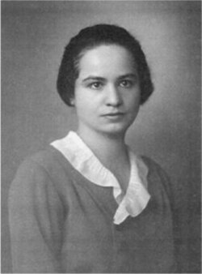

# Marietta Blau

**Born:** 29 April 1894

**Died / status:** 27 January 1970

**Fields:** Particle detection, Cosmic rays

Sourced photograph or portrait; the image record identifies its creator, provenance, and reuse conditions.

## Biography

An Austrian experimental physicist, Blau studied radioactivity in Vienna before Nazi persecution forced her to leave Europe. Working later in Mexico and the United States, she developed photographic emulsions into quantitative records of microscopic particle tracks.

## Major contributions to physics

- Developed nuclear emulsions for identifying energetic charged particles.
- Discovered cosmic-ray-induced nuclear-disintegration stars with Hertha Wambacher.
- Established experimental foundations for later emulsion-based particle discoveries.

## Image source and rights

- Source: [Original image record](https://en.wikipedia.org/wiki/File:Marietta_Blau.jpg)
- Creator / attribution: See the original image record
- License or rights statement: Copyrighted or republication permission unverified; consult the original record
- Local image: [58cd738edbe917ae417e-2b3e4b26b9.jpg](../portraits/58cd738edbe917ae417e-2b3e4b26b9.jpg)
- Republication: permission for use on a public website has not been verified. Confirm permission with the rightsholder or replace the image before publication.

## Sources

- [Marietta Blau — reference biography (en.wikipedia.org)](https://en.wikipedia.org/wiki/Marietta_Blau)

Record reviewed: 2026-10-26.
