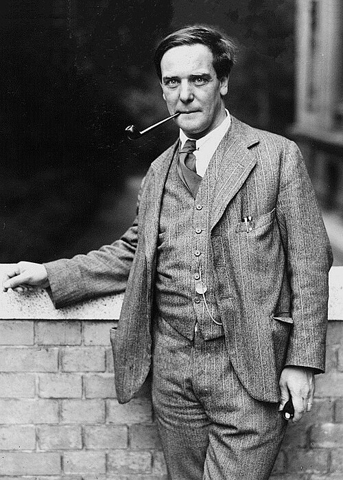

# Pyotr Leonidovich Kapitsa

**Born:** 9 July 1894

**Died / status:** 8 April 1984

**Fields:** Low-temperature physics, Superfluidity

For the photographer or artist, date and type of image, consult the original image record.

## Biography

Pyotr Leonidovich Kapitsa was born in Kronshtadt, Russian Empire (now Russia) and conducted research in low-temperature physics and superfluidity. Nobel records list Academy of Sciences as the affiliation at the time of the award. They developed experimental methods for low temperatures and strong magnetic fields. They were awarded the Nobel Prize in Physics in 1978.

## Major contributions to physics

- Developed experimental methods for low temperatures and strong magnetic fields
- Discovered and investigated the superfluid properties of liquid helium

**Nobel Prize in Physics:** 1978

## Image source and rights

- Source: [Original image record](https://commons.wikimedia.org/wiki/File:Pyotr_Kapitsa_1930s.jpg)
- Creator / attribution: Unknown (Mondadori Publishers)
- License or rights statement: Public domain
- Local image: [b314661254dd8bd88cf9.jpg](../portraits/b314661254dd8bd88cf9.jpg)
- Credit: http://www.gettyimages.co.uk/detail/news-photo/portrait-of-the-russian-physicist-pjotr-kapitza-1930s-news-photo/141551184

## Sources

- [Pyotr Kapitsa - Facts](https://www.nobelprize.org/prizes/physics/1978/kapitsa/facts/)
- [Nobel Prize official laureate API, id 110](https://api.nobelprize.org/2.1/laureate/110)
- [Wikipedia: Pyotr Kapitsa](https://en.wikipedia.org/wiki/Pyotr_Kapitsa)

Record reviewed: 2026-10-26.
