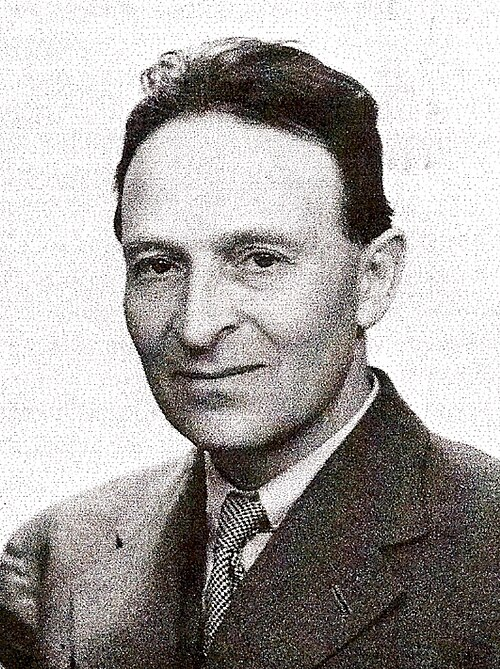

# Oskar Klein

**Born:** 15 September 1894

**Died / status:** 5 February 1977

**Fields:** Quantum field theory, Unified-field theory

Sourced photograph or portrait; the image record identifies its creator, provenance, and reuse conditions.

## Biography

Klein was a Swedish theoretical physicist who worked in Copenhagen, Michigan, and Stockholm. He contributed to early relativistic quantum mechanics and explored extra spatial dimensions as a route toward unified interactions.

## Major contributions to physics

- Independently developed the relativistic scalar wave equation also associated with Gordon.
- Advanced five-dimensional Kaluza–Klein theory.
- Derived the Klein–Nishina photon-scattering formula with Yoshio Nishina.

## Image source and rights

- Source: [Original image record](https://commons.wikimedia.org/wiki/File:OskarKlein.jpg)
- Creator / attribution: Royal Norwegian Society of Sciences and Letters
- License or rights statement: [CC BY-SA 4.0](https://creativecommons.org/licenses/by-sa/4.0)
- Local image: [21a354a2f6cd4bf7ac4f.jpg](../portraits/21a354a2f6cd4bf7ac4f.jpg)
- Credit: https://arxiv.org/pdf/1309.4113.pdf

## Sources

- [Oskar Klein — reference biography (en.wikipedia.org)](https://en.wikipedia.org/wiki/Oskar_Klein)

Record reviewed: 2026-10-26.
