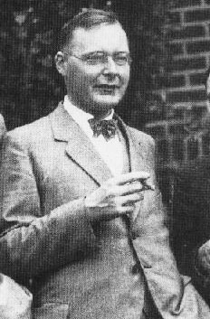

# Hendrik Kramers

**Born:** 17 December 1894

**Died / status:** 24 April 1952

**Fields:** Quantum mechanics, Statistical physics

Sourced photograph or portrait; the image record identifies its creator, provenance, and reuse conditions.

## Biography

A Dutch theoretical physicist, Kramers worked with Bohr in Copenhagen before holding chairs in Utrecht and Leiden. His research ranged from old quantum theory and dispersion to stochastic processes during the formative period of quantum mechanics.

## Major contributions to physics

- Developed the Kramers–Heisenberg dispersion formula.
- Contributed to the semiclassical WKB approximation.
- Developed thermally activated escape-rate theory and investigated quantum degeneracy.

## Image source and rights

- Source: [Original image record](https://commons.wikimedia.org/wiki/File:Kramers_1928.jpg)
- Creator / attribution: File:UhlenbeckKramersGoudsmit.jpg
- License or rights statement: Public domain
- Local image: [76d51c0dbce66cfefa28.jpg](../portraits/76d51c0dbce66cfefa28.jpg)
- Credit: File:UhlenbeckKramersGoudsmit.jpg

## Sources

- [Hendrik Kramers — reference biography (en.wikipedia.org)](https://en.wikipedia.org/wiki/Hendrik_Kramers)

Record reviewed: 2026-10-26.
