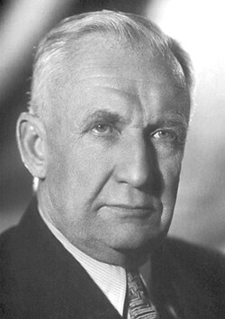

# Igor Yevgenyevich Tamm

**Born:** 8 July 1895

**Died / status:** 12 April 1971

**Fields:** Theoretical physics, Radiation physics

For the photographer or artist, date and type of image, consult the original image record.

## Biography

Igor Yevgenyevich Tamm was born in Vladivostok, Russia and conducted research in theoretical physics and radiation physics. Nobel records list Lomonosov Moscow State University and P.N. Lebedev Physical Institute as the affiliations at the time of the award. They developed the theoretical explanation of Cherenkov radiation with Ilya Frank. They were awarded the Nobel Prize in Physics in 1958.

## Major contributions to physics

- Developed the theoretical explanation of Cherenkov radiation with Ilya Frank
- Contributed to quantum theory and condensed-matter physics

**Nobel Prize in Physics:** 1958

## Image source and rights

- Source: [Original image record](https://commons.wikimedia.org/wiki/File:Igor_Tamm.jpg)
- Creator / attribution: Nobel foundation
- License or rights statement: Public domain
- Local image: [361fbefe43c810ba1715.jpg](../portraits/361fbefe43c810ba1715.jpg)
- Credit: http://nobelprize.org/nobel_prizes/physics/laureates/1958/tamm-bio.html

## Sources

- [Igor Y. Tamm - Facts](https://www.nobelprize.org/prizes/physics/1958/tamm/facts/)
- [Nobel Prize official laureate API, id 71](https://api.nobelprize.org/2.1/laureate/71)
- [Wikipedia: Igor Tamm](https://en.wikipedia.org/wiki/Igor_Tamm)

Record reviewed: 2026-10-26.
