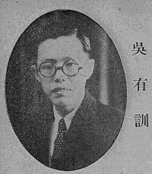

# Wu Youxun

**Born:** 26 April 1897

**Died / status:** 30 November 1977

**Fields:** Atomic physics, X-ray physics

Sourced photograph or portrait; the image record identifies its creator, provenance, and reuse conditions.

## Biography

Born in Gao'an, Jiangxi, Wu trained with Compton at the University of Chicago and later taught at Tsinghua and the National Southwestern Associated University. He helped organize the Chinese Physical Society and develop modern physics research and university education in China.

## Major contributions to physics

- Performed X-ray scattering experiments testing and extending research on the Compton effect.
- Investigated relations between scattering intensity, elemental properties, and atomic structure.
- Built experimental-physics teaching and research institutions in China.

## Image source and rights

- Source: [Original image record](https://commons.wikimedia.org/wiki/File:%E5%90%B3%E6%9C%89%E8%A8%93.jpg)
- Creator / attribution: 杨家骆（原刊编者）; Photographer not identified
- License or rights statement: Public domain — Commons source tag (PD-China or PD-scan)
- Local image: [d2f190a63d9cd39929c7-ba09241164.jpg](../portraits/d2f190a63d9cd39929c7-ba09241164.jpg)
- Credit: Original credit is retained in the source record.

## Sources

- [Wu Youxun — biographical or institutional source (xsg.tsinghua.edu.cn)](https://xsg.tsinghua.edu.cn/info/1003/1296.htm)
- [Wu Youxun — reference biography (en.wikipedia.org)](https://en.wikipedia.org/wiki/Wu_Youxun)

Record reviewed: 2026-10-26.
