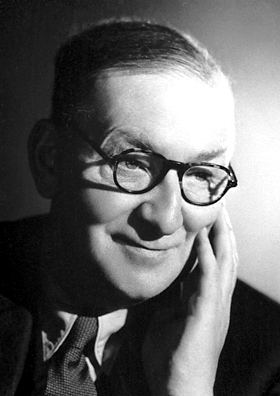

# Sir John Douglas Cockcroft

**Born:** 27 May 1897

**Died / status:** 18 September 1967

**Fields:** Nuclear physics, Accelerator physics

For the photographer or artist, date and type of image, consult the original image record.

## Biography

Sir John Douglas Cockcroft was born in Todmorden, United Kingdom and conducted research in nuclear physics and accelerator physics. Nobel records list Atomic Energy Research Establishment as the affiliation at the time of the award. They produced nuclear transformations using artificially accelerated charged particles. They were awarded the Nobel Prize in Physics in 1951.

## Major contributions to physics

- Produced nuclear transformations using artificially accelerated charged particles
- Developed early high-voltage particle-accelerator experiments

**Nobel Prize in Physics:** 1951

## Image source and rights

- Source: [Original image record](https://commons.wikimedia.org/wiki/File:Cockcroft.jpg)
- Creator / attribution: Nobel foundation
- License or rights statement: Public domain
- Local image: [4a0e7437c684718ecab3.jpg](../portraits/4a0e7437c684718ecab3.jpg)
- Credit: http://nobelprize.org/nobel_prizes/physics/laureates/1951/cockcroft-bio.html

## Sources

- [John Cockcroft - Facts](https://www.nobelprize.org/prizes/physics/1951/cockcroft/facts/)
- [Nobel Prize official laureate API, id 56](https://api.nobelprize.org/2.1/laureate/56)
- [Wikipedia: John Cockcroft](https://en.wikipedia.org/wiki/John_Cockcroft)

Record reviewed: 2026-10-26.
