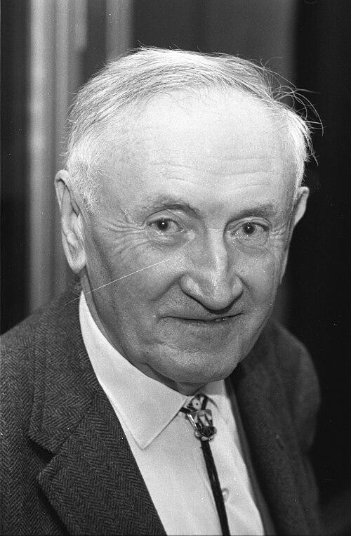

# Fritz Zwicky

**Born:** 14 February 1898

**Died / status:** 8 February 1974

**Fields:** Astrophysics, Observational cosmology

Sourced photograph or portrait; the image record identifies its creator, provenance, and reuse conditions.

## Biography

A Swiss astrophysicist at Caltech and Palomar Observatory, Zwicky used observational anomalies to propose bold physical explanations. He studied galaxy clusters, supernovae, and stellar remnants and organized extensive astronomical surveys.

## Major contributions to physics

- Inferred substantial unseen matter from the dynamics of the Coma galaxy cluster.
- Connected supernovae with neutron stars in work with Walter Baade.
- Proposed using galaxy clusters as gravitational lenses.

## Image source and rights

- Source: [Original image record](https://commons.wikimedia.org/wiki/File:Fritz_Zwicky_in_1970_%282%29.jpg)
- Creator / attribution: Comet Photo AG (Zürich)
- License or rights statement: [CC BY-SA 4.0](https://commons.wikimedia.org/wiki/File:Fritz_Zwicky_in_1970_%282%29.jpg)
- Local image: [018cb58289298dfa2929.jpg](../portraits/018cb58289298dfa2929.jpg)
- Credit: http://doi.org/10.3932/ethz-a-000050128

## Sources

- [Fritz Zwicky — reference biography (en.wikipedia.org)](https://en.wikipedia.org/wiki/Fritz_Zwicky)

Record reviewed: 2026-10-26.
