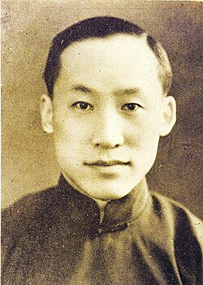

# Ye Qisun

**Born:** 16 July 1898

**Died / status:** 13 January 1977

**Fields:** Experimental physics, Magnetism

Sourced photograph or portrait; the image record identifies its creator, provenance, and reuse conditions.

## Biography

Born in Shanghai, Ye earned his doctorate at Harvard and helped found Tsinghua University's physics department after returning to China. He linked teaching with research and recruited and trained influential members of China's modern physics community.

## Major contributions to physics

- Precisely measured Planck's constant with Duane and Palmer.
- Investigated the magnetic properties of ferromagnetic materials under pressure.
- Built physics teaching and research institutions and trained Chinese physicists.

## Image source and rights

- Source: [Original image record](https://commons.wikimedia.org/wiki/File:Ye_Qisun.jpg)
- Creator / attribution: Unknown author
- License or rights statement: Public domain
- Local image: [2c553543a51d8a41b7a6.jpg](../portraits/2c553543a51d8a41b7a6.jpg)
- Credit: http://news.xinhuanet.com/book/2011-04/25/c_121344524_4.htm

## Sources

- [Ye Qisun — biographical or institutional source (yswk.csdl.ac.cn)](https://yswk.csdl.ac.cn/ys_detail?casid=1955A23)
- [Ye Qisun — reference biography (en.wikipedia.org)](https://en.wikipedia.org/wiki/Ye_Qisun)

Record reviewed: 2026-10-26.
