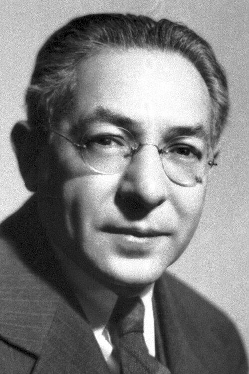

# Isidor Isaac Rabi

**Born:** 29 July 1898

**Died / status:** 11 January 1988

**Fields:** Atomic physics, Magnetic resonance

For the photographer or artist, date and type of image, consult the original image record.

## Biography

Isidor Isaac Rabi was born in Rymanow, Austria-Hungary (now Poland) and conducted research in atomic physics and magnetic resonance. Nobel records list Columbia University as the affiliation at the time of the award. They developed the molecular-beam magnetic-resonance method. They were awarded the Nobel Prize in Physics in 1944.

## Major contributions to physics

- Developed the molecular-beam magnetic-resonance method
- Used resonance to measure nuclear magnetic moments precisely

**Nobel Prize in Physics:** 1944

## Image source and rights

- Source: [Original image record](https://commons.wikimedia.org/wiki/File:II_Rabi.jpg)
- Creator / attribution: Nobel Foundation
- License or rights statement: Public domain
- Local image: [eb410a762a7fef40ae60.jpg](../portraits/eb410a762a7fef40ae60.jpg)
- Credit: http://nobelprize.org/nobel_prizes/physics/laureates/1944/rabi-bio.html

## Sources

- [Isidor Isaac Rabi - Facts](https://www.nobelprize.org/prizes/physics/1944/rabi/facts/)
- [Nobel Prize official laureate API, id 49](https://api.nobelprize.org/2.1/laureate/49)
- [Wikipedia: Isidor Isaac Rabi](https://en.wikipedia.org/wiki/Isidor_Isaac_Rabi)

Record reviewed: 2026-10-26.
