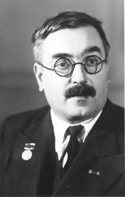

# Vladimir Fock

**Born:** 22 December 1898

**Died / status:** 27 December 1974

**Fields:** Quantum mechanics, Quantum field theory

Sourced photograph or portrait; the image record identifies its creator, provenance, and reuse conditions.

## Biography

A Soviet theoretical physicist based at Leningrad University, Fock applied rigorous mathematics to atomic structure and field theory. He was an important early developer of quantum theory and also investigated relativity and gravitation.

## Major contributions to physics

- Developed Fock-space descriptions of systems with variable particle number.
- Developed the exchange-inclusive Hartree–Fock method from the self-consistent-field approach.
- Investigated relativistic quantum theory and gravitation.

## Image source and rights

- Source: [Original image record](https://en.wikipedia.org/wiki/File:Vladimir_Fock_-_photo.jpg)
- Creator / attribution: See the original image record
- License or rights statement: Copyrighted or republication permission unverified; consult the original record
- Local image: [a01007b291b426b732ab-cd4af83644.jpg](../portraits/a01007b291b426b732ab-cd4af83644.jpg)
- Republication: permission for use on a public website has not been verified. Confirm permission with the rightsholder or replace the image before publication.

## Sources

- [Vladimir Fock — biographical or institutional source (www.mathsoc.spb.ru)](https://www.mathsoc.spb.ru/pantheon/fock/)
- [Vladimir Fock — biographical or institutional source (mathshistory.st-andrews.ac.uk)](https://mathshistory.st-andrews.ac.uk/Biographies/Fock/)
- [Vladimir Fock — reference biography (en.wikipedia.org)](https://en.wikipedia.org/wiki/Vladimir_Fock)

Record reviewed: 2026-10-26.
