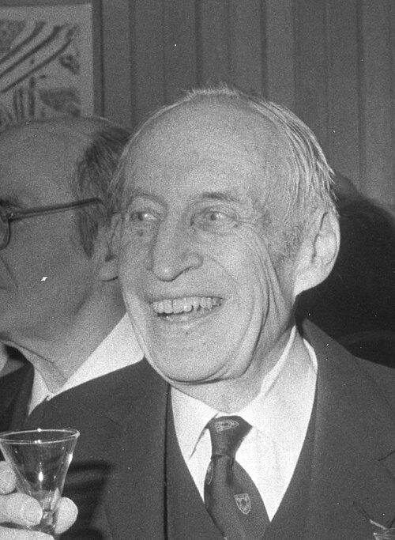

# John Hasbrouck Van Vleck

**Born:** 13 March 1899

**Died / status:** 27 October 1980

**Fields:** Condensed-matter physics, Magnetism

For the photographer or artist, date and type of image, consult the original image record.

## Biography

John Hasbrouck Van Vleck was born in Middletown, CT, USA and conducted research in condensed-matter physics and magnetism. Nobel records list Harvard University as the affiliation at the time of the award. They explained paramagnetism and diamagnetism using quantum mechanics. They were awarded the Nobel Prize in Physics in 1977.

## Major contributions to physics

- Explained paramagnetism and diamagnetism using quantum mechanics
- Developed theories of magnetic-ion electronic structure and magnetic susceptibility in crystals

**Nobel Prize in Physics:** 1977

## Image source and rights

- Source: [Original image record](https://commons.wikimedia.org/wiki/File:John_H._Van_Vleck.jpg)
- Creator / attribution: Photograph by E.B. Boatner, courtesy AIP Emilio Segrè Visual Archives, Bainbridge Collection
- License or rights statement: Attribution
- Local image: [d1897e8ab365543cd2d4.jpg](../portraits/d1897e8ab365543cd2d4.jpg)
- Credit: https://repository.aip.org/edwin-kemble-john-h-van-vleck-and-robert-serber-kembles-90th-birthday-party

## Sources

- [John H. Van Vleck - Facts](https://www.nobelprize.org/prizes/physics/1977/vleck/facts/)
- [Nobel Prize official laureate API, id 109](https://api.nobelprize.org/2.1/laureate/109)
- [Wikipedia: John Hasbrouck Van Vleck](https://en.wikipedia.org/wiki/John_Hasbrouck_Van_Vleck)

Record reviewed: 2026-10-26.
