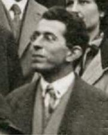

# Fritz London

**Born:** 7 March 1900

**Died / status:** 30 March 1954

**Fields:** Condensed-matter physics, Quantum chemistry

Sourced photograph or portrait; the image record identifies its creator, provenance, and reuse conditions.

## Biography

A German-born theorist, London worked in several European centres before joining Duke University. His applications of quantum theory to chemical bonding, intermolecular forces, and low-temperature matter helped establish the physics of macroscopic quantum phenomena.

## Major contributions to physics

- Developed the quantum valence-bond treatment of hydrogen with Heitler.
- Explained dispersion forces between nonpolar atoms and molecules.
- Developed the London equations of superconducting electrodynamics with Heinz London.

## Image source and rights

- Source: [Original image record](https://commons.wikimedia.org/wiki/File:London,Fritz_1928_M%C3%BCnchen.jpg)
- Creator / attribution: GFHund
- License or rights statement: [CC BY 3.0](https://creativecommons.org/licenses/by/3.0)
- Local image: [85457e935aa3000dc656.jpg](../portraits/85457e935aa3000dc656.jpg)
- Credit: Own work

## Sources

- [Fritz London — reference biography (en.wikipedia.org)](https://en.wikipedia.org/wiki/Fritz_London)

Record reviewed: 2026-10-26.
