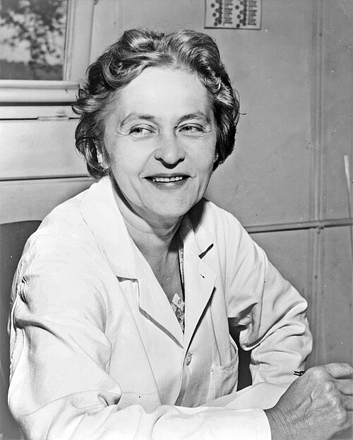

# Maria Telkes

**Born:** 12 December 1900

**Died / status:** 2 December 1995

**Fields:** Solar-energy physics, Energy technology

Sourced photograph or portrait; the image record identifies its creator, provenance, and reuse conditions.

## Biography

A Hungarian-born American physical chemist, Telkes investigated solar-energy conversion and storage in industry and at MIT. She applied materials science and thermal physics to solar-heated buildings, desalination, and thermoelectric devices.

## Major contributions to physics

- Developed solar-heat collection and phase-change thermal storage.
- Helped design early solar-heated houses.
- Investigated solar distillation and thermoelectric energy conversion.

## Image source and rights

- Source: [Original image record](https://commons.wikimedia.org/wiki/File:Maria_Telkes_NYWTS.jpg)
- Creator / attribution: New York World-Telegram and the Sun staff photographer
- License or rights statement: Public domain
- Local image: [08d2953d26ebf89a9ac8.jpg](../portraits/08d2953d26ebf89a9ac8.jpg)
- Credit: Library of Congress Prints and Photographs Division. New York World-Telegram and the Sun Newspaper Photograph Collection. http://hdl.loc.gov/loc.pnp/cph.3c13268

## Sources

- [Maria Telkes — reference biography (en.wikipedia.org)](https://en.wikipedia.org/wiki/Maria_Telkes)

Record reviewed: 2026-10-26.
