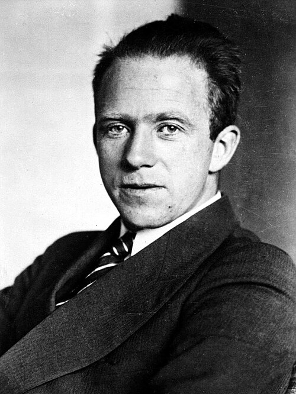

# Werner Karl Heisenberg

**Born:** 5 December 1901

**Died / status:** 1 February 1976

**Fields:** Quantum mechanics, Mathematical physics

For the photographer or artist, date and type of image, consult the original image record.

## Biography

Werner Karl Heisenberg was born in Würzburg, Germany and conducted research in quantum mechanics and mathematical physics. Nobel records list Leipzig University as the affiliation at the time of the award. They established matrix mechanics as a formulation of quantum mechanics. They were awarded the Nobel Prize in Physics in 1932.

## Major contributions to physics

- Established matrix mechanics as a formulation of quantum mechanics
- Formulated the uncertainty relation and investigated atomic nuclei and elementary particles

**Nobel Prize in Physics:** 1932

## Image source and rights

- Source: [Original image record](https://commons.wikimedia.org/wiki/File:Werner_Heisenberg_Portrait_(3x4_cropped).jpg)
- Creator / attribution: Unknown author
- License or rights statement: [CC BY-SA 3.0 de](https://creativecommons.org/licenses/by-sa/3.0/de/deed.en)
- Local image: [67c0a5a43e2440579b6f.jpg](../portraits/67c0a5a43e2440579b6f.jpg)
- Credit: This image was provided to Wikimedia Commons by the German Federal Archive (Deutsches Bundesarchiv) as part of a cooperation project. The German Federal Archive guarantees an authentic representation only using the originals (negative and/or positive), resp. the digitalization of the originals as provided by the Digital Image Archive.

## Sources

- [Werner Heisenberg - Facts](https://www.nobelprize.org/prizes/physics/1932/heisenberg/facts/)
- [Nobel Prize official laureate API, id 38](https://api.nobelprize.org/2.1/laureate/38)
- [Wikipedia: Werner Heisenberg](https://en.wikipedia.org/wiki/Werner_Heisenberg)

Record reviewed: 2026-10-26.
