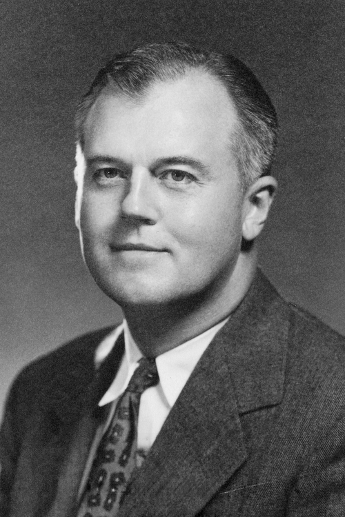

# Robert J. Van de Graaff

**Born:** 20 December 1901

**Died / status:** 16 January 1967

**Fields:** Accelerator physics

Sourced photograph or portrait; the image record identifies its creator, provenance, and reuse conditions.

## Biography

An American experimental physicist educated partly at Oxford, Van de Graaff worked at Princeton and MIT. His mechanical transport of electric charge provided high voltages and an important tool for nuclear experiments.

## Major contributions to physics

- Invented the Van de Graaff electrostatic accelerator.
- Developed high-voltage generation, insulation, and charged-particle acceleration.
- Advanced electrostatic accelerators for nuclear-reaction and structure research.

## Image source and rights

- Source: [Original image record](https://commons.wikimedia.org/wiki/File:Robert_J_van_de_Graaff_faculty_portrait_cropped.png)
- Creator / attribution: Unknown author
- License or rights statement: Public domain
- Local image: [031a850e1e98adbbaff2.png](../portraits/031a850e1e98adbbaff2.png)
- Credit: MIT Museum, GCP-00027002

## Sources

- [Robert J. Van de Graaff — reference biography (en.wikipedia.org)](https://en.wikipedia.org/wiki/Robert_J._Van_de_Graaff)

Record reviewed: 2026-10-26.
