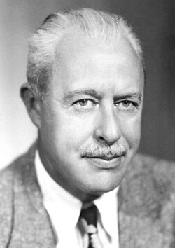

# Walter Houser Brattain

**Born:** 10 February 1902

**Died / status:** 13 October 1987

**Fields:** Semiconductor physics, Electronic devices

For the photographer or artist, date and type of image, consult the original image record.

## Biography

Walter Houser Brattain was born in Amoy, China and conducted research in semiconductor physics and electronic devices. Nobel records list Bell Telephone Laboratories as the affiliation at the time of the award. They investigated semiconductors and contributed to the invention of the transistor. They were awarded the Nobel Prize in Physics in 1956.

## Major contributions to physics

- Investigated semiconductors and contributed to the invention of the transistor
- Established important foundations of solid-state electronics and microelectronics

**Nobel Prize in Physics:** 1956

## Image source and rights

- Source: [Original image record](https://commons.wikimedia.org/wiki/File:Brattain.jpg)
- Creator / attribution: Nobel foundation
- License or rights statement: Public domain
- Local image: [f9473c968d7693e65c8b.jpg](../portraits/f9473c968d7693e65c8b.jpg)
- Credit: http://nobelprize.org/nobel_prizes/physics/laureates/1956/brattain-bio.html

## Sources

- [Walter H. Brattain - Facts](https://www.nobelprize.org/prizes/physics/1956/brattain/facts/)
- [Nobel Prize official laureate API, id 67](https://api.nobelprize.org/2.1/laureate/67)
- [Wikipedia: Walter Houser Brattain](https://en.wikipedia.org/wiki/Walter_Houser_Brattain)

Record reviewed: 2026-10-26.
