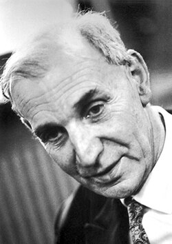

# Alfred Kastler

**Born:** 3 May 1902

**Died / status:** 7 January 1984

**Fields:** Atomic physics, Optics

For the photographer or artist, date and type of image, consult the original image record.

## Biography

Alfred Kastler was born in Guebwiller, Germany (now France) and conducted research in atomic physics and optics. Nobel records list École Normale Supérieure as the affiliation at the time of the award. They proposed and developed optical pumping. They were awarded the Nobel Prize in Physics in 1966.

## Major contributions to physics

- Proposed and developed optical pumping
- Used light-atom interactions to prepare and investigate non-equilibrium atomic states

**Nobel Prize in Physics:** 1966

## Image source and rights

- Source: [Original image record](https://commons.wikimedia.org/wiki/File:Kastler.jpg)
- Creator / attribution: Nobel foundation
- License or rights statement: Public domain
- Local image: [6df70fc064c97100ddca.jpg](../portraits/6df70fc064c97100ddca.jpg)
- Credit: https://nobelprize.org/nobel_prizes/physics/laureates/1966/kastler-bio.html

## Sources

- [Alfred Kastler - Facts](https://www.nobelprize.org/prizes/physics/1966/kastler/facts/)
- [Nobel Prize official laureate API, id 87](https://api.nobelprize.org/2.1/laureate/87)
- [Wikipedia: Alfred Kastler](https://en.wikipedia.org/wiki/Alfred_Kastler)

Record reviewed: 2026-10-26.
