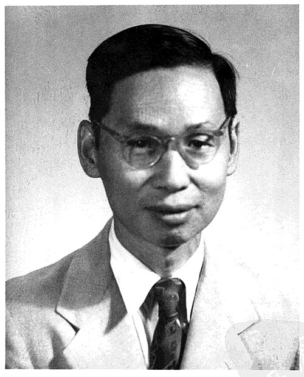

# Zhao Zhongyao

**Born:** 27 June 1902

**Died / status:** 28 May 1998

**Fields:** Nuclear physics, Experimental physics

Sourced photograph or portrait; the image record identifies its creator, provenance, and reuse conditions.

## Biography

Born in Zhuji, Zhejiang, Zhao obtained his doctorate at Caltech and taught at Tsinghua. After returning to China he helped establish atomic-energy and high-energy-physics institutions, emphasizing particle detection, accelerators, and the training of experimentalists.

## Major contributions to physics

- Measured anomalous absorption and secondary radiation of energetic gamma rays in heavy elements, providing early evidence relevant to pair processes.
- Advanced electrostatic accelerators and nuclear experiments in China.
- Trained nuclear and high-energy physicists.

## Image source and rights

- Source: [Original image record](https://commons.wikimedia.org/wiki/File:%E8%B6%99%E5%BF%A0%E5%A0%AF.jpg)
- Creator / attribution: Unknown
- License or rights statement: Public domain
- Local image: [f96cb77ab37075f95131.jpg](../portraits/f96cb77ab37075f95131.jpg)
- Credit: Original credit is retained in the source record.

## Sources

- [Zhao Zhongyao — biographical or institutional source (www.cas.cn)](https://www.cas.cn/xzfc/202207/t20220714_4841665.shtml)
- [Zhao Zhongyao — reference biography (en.wikipedia.org)](https://en.wikipedia.org/wiki/Zhao_Zhongyao)

Record reviewed: 2026-10-26.
