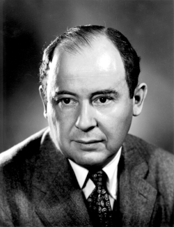

# John von Neumann

**Born:** 28 December 1903

**Died / status:** 8 February 1957

**Fields:** Mathematical physics, Quantum mechanics, Computational physics

Sourced photograph or portrait; the image record identifies its creator, provenance, and reuse conditions.

## Biography

A Hungarian-born mathematician at the Institute for Advanced Study, von Neumann shaped the mathematical foundations of quantum theory, operator algebras, and electronic computing. He also worked on computational and applied-mathematical problems at Los Alamos.

## Major contributions to physics

- Systematized quantum mechanics using Hilbert spaces and operators.
- Developed operator-algebra and quantum-statistical methods.
- Advanced electronic computing and numerical approaches to physical problems.

## Image source and rights

- Source: [Original image record](https://commons.wikimedia.org/wiki/File:JohnvonNeumann-LosAlamos.gif)
- Creator / attribution: LANL
- License or rights statement: Attribution
- Local image: [389f6488c1f0c52bf363.gif](../portraits/389f6488c1f0c52bf363.gif)
- Credit: http://www.lanl.gov/history/atomicbomb/images/NeumannL.GIF (archive copy at the Wayback Machine)

## Sources

- [John von Neumann — reference biography (en.wikipedia.org)](https://en.wikipedia.org/wiki/John_von_Neumann)

Record reviewed: 2026-10-26.
