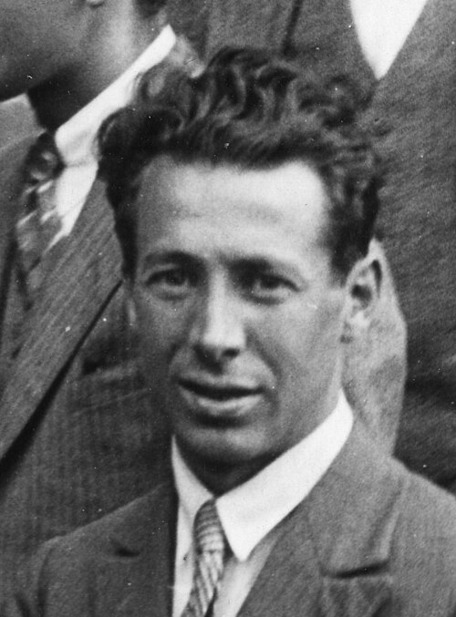

# Walter Heitler

**Born:** 2 January 1904

**Died / status:** 15 November 1981

**Fields:** Quantum electrodynamics, Quantum chemistry

Sourced photograph or portrait; the image record identifies its creator, provenance, and reuse conditions.

## Biography

A German-born theoretical physicist, Heitler worked with Born in Göttingen and later in Bristol, Dublin, and Zürich. His research connected molecular bonding with high-energy radiation processes, and his quantum-radiation text became influential.

## Major contributions to physics

- Developed the quantum valence-bond theory of hydrogen with Fritz London.
- Investigated electron–positron production and radiation with Bethe.
- Developed theories of electromagnetic cascades.

## Image source and rights

- Source: [Original image record](https://commons.wikimedia.org/wiki/File:Walter_Heitler.jpg)
- Creator / attribution: Fot. Comm. A. Petitti, Roma, courtesy of AIP Emilio Segrè Visual Archives, Goudsmit Collection
- License or rights statement: Attribution
- Local image: [732372ff282fe5654607.jpg](../portraits/732372ff282fe5654607.jpg)
- Credit: https://repository.aip.org/robert-millikan-jean-baptiste-perrin-george-placzek-guido-beck-samuel-goudsmit-walter-heitler

## Sources

- [Walter Heitler — reference biography (en.wikipedia.org)](https://en.wikipedia.org/wiki/Walter_Heitler)

Record reviewed: 2026-10-26.
