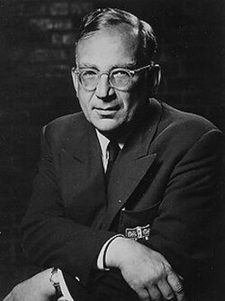

# George Gamow

**Born:** 4 March 1904

**Died / status:** 19 August 1968

**Fields:** Nuclear physics, Cosmology

Sourced photograph or portrait; the image record identifies its creator, provenance, and reuse conditions.

## Biography

Born in Odessa, Gamow studied in Europe before moving to the United States and teaching at George Washington University and elsewhere. His work ranged from nuclear physics to the early universe and popular science, helping develop hot Big Bang cosmology.

## Major contributions to physics

- Explained nuclear alpha decay through quantum tunnelling.
- Developed early-universe nucleosynthesis with Alpher and collaborators.
- Introduced Gamow–Teller beta transitions with Edward Teller.

## Historical and source notes

- The birth date uses the Gregorian calendar; some Russian historical sources also give the Julian date.

## Image source and rights

- Source: [Original image record](https://en.wikipedia.org/wiki/File:George_Gamow.jpg)
- Creator / attribution: See the original image record
- License or rights statement: Copyrighted or republication permission unverified; consult the original record
- Local image: [47a9c8b1d3ba9db86ba7-b37fbd50cf.jpg](../portraits/47a9c8b1d3ba9db86ba7-b37fbd50cf.jpg)
- Republication: permission for use on a public website has not been verified. Confirm permission with the rightsholder or replace the image before publication.

## Sources

- [George Gamow — reference biography (en.wikipedia.org)](https://en.wikipedia.org/wiki/George_Gamow)

Record reviewed: 2026-10-26.
