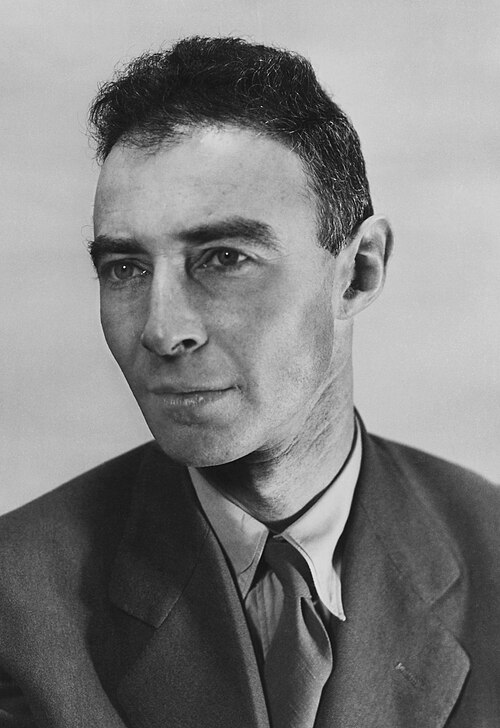

# J. Robert Oppenheimer

**Born:** 22 April 1904

**Died / status:** 18 February 1967

**Fields:** Theoretical physics, Nuclear physics, Astrophysics

Sourced photograph or portrait; the image record identifies its creator, provenance, and reuse conditions.

## Biography

An American theorist at Berkeley and Caltech, Oppenheimer directed Los Alamos during the Second World War and later led the Institute for Advanced Study. His scientific career had a major intersection with public policy.

## Major contributions to physics

- Developed the Born–Oppenheimer approximation separating electronic and nuclear motion.
- Investigated gravitational collapse of massive stars with Snyder.
- Organized theoretical and experimental collaboration in the Manhattan Project.

## Image source and rights

- Source: [Original image record](https://commons.wikimedia.org/wiki/File:Oppenheimer_(cropped).jpg)
- Creator / attribution: Unknown author
- License or rights statement: Public domain
- Local image: [98d3d3f775355f5279f8.jpg](../portraits/98d3d3f775355f5279f8.jpg)
- Credit: https://catalog.archives.gov/id/558579

## Sources

- [J. Robert Oppenheimer — reference biography (en.wikipedia.org)](https://en.wikipedia.org/wiki/J._Robert_Oppenheimer)

Record reviewed: 2026-10-26.
