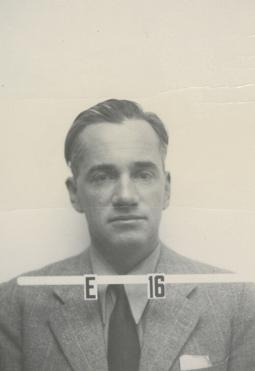

# Otto Robert Frisch

**Born:** 1 October 1904

**Died / status:** 22 September 1979

**Fields:** Nuclear physics, Experimental physics

Sourced portrait or photograph; see the image record for provenance and reuse conditions.

## Biography

An Austrian-born British physicist, Frisch worked in Germany, Copenhagen and Britain, leaving Germany under Nazi persecution. He explained nuclear fission with his aunt Lise Meitner, later participated in wartime nuclear research, and pursued nuclear physics and instrumentation at Cambridge.

## Major contributions to physics

- With Meitner, interpreted Hahn and Strassmann's chemical results as the splitting of a heavy nucleus and estimated the large energy release.
- Confirmed the high energy of fission fragments through ionization-pulse experiments and introduced the term fission.
- Wrote the 1940 Frisch–Peierls memorandum with Rudolf Peierls, identifying the feasibility of a nuclear explosion using a fissile isotope.

## Image source and rights

- Source: [Original image record](https://commons.wikimedia.org/wiki/File:Otto_Frisch_Los_Alamos_ID_badge_photo.jpg)
- Creator / attribution: Los Alamos Laboratory
- License or rights statement: Attribution
- Local image: [2dc8710d928344db0f52-cace92d3c1.jpg](../portraits/2dc8710d928344db0f52-cace92d3c1.jpg)
- Credit: Otto R. Frisch badge photo, Los Alamos National Laboratory

## Sources

- [Trinity College Cambridge — Papers of Otto Frisch](https://archives.trin.cam.ac.uk/index.php/papers-of-otto-robert-frisch)
- [Royal Society — Otto Robert Frisch](https://makingscience.royalsociety.org/people/na6099/otto-robert-frisch)
- [Otto Robert Frisch — reference biography](https://en.wikipedia.org/wiki/Otto_Robert_Frisch)

Record reviewed: 2026-10-26.
