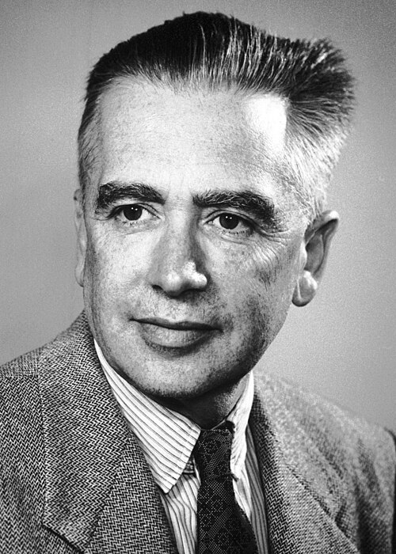

# Emilio Gino Segrè

**Born:** 1 February 1905

**Died / status:** 22 April 1989

**Fields:** Particle physics, Antimatter

For the photographer or artist, date and type of image, consult the original image record.

## Biography

Emilio Gino Segrè was born in Tivoli, Italy and conducted research in particle physics and antimatter. Nobel records list University of California as the affiliation at the time of the award. They discovered the antiproton in accelerator experiments. They were awarded the Nobel Prize in Physics in 1959.

## Major contributions to physics

- Discovered the antiproton in accelerator experiments
- Provided experimental evidence important to antimatter and particle-antiparticle symmetry

**Nobel Prize in Physics:** 1959

## Image source and rights

- Source: [Original image record](https://commons.wikimedia.org/wiki/File:Segre.jpg)
- Creator / attribution: Nobel foundation
- License or rights statement: Public domain
- Local image: [41ecd6a1cb35c980fdc7.jpg](../portraits/41ecd6a1cb35c980fdc7.jpg)
- Credit: https://nobelprize.org/nobel_prizes/physics/laureates/1959/segre-bio.html

## Sources

- [Emilio Segrè - Facts](https://www.nobelprize.org/prizes/physics/1959/segre/facts/)
- [Nobel Prize official laureate API, id 72](https://api.nobelprize.org/2.1/laureate/72)
- [Wikipedia: Emilio G. Segrè](https://en.wikipedia.org/wiki/Emilio_G._Segr%C3%A8)

Record reviewed: 2026-10-26.
