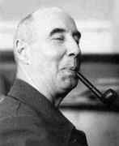

# Ernst Stueckelberg

**Born:** 1 February 1905

**Died / status:** 4 September 1984

**Fields:** Quantum field theory, Particle physics

Sourced portrait or photograph; see the image record for provenance and reuse conditions.

## Biography

A Swiss theorist who worked in Europe and the United States, Stueckelberg taught in Geneva and Lausanne. Several of his field-theory ideas anticipated later widely adopted formulations but initially received limited recognition.

## Major contributions to physics

- Developed relativistically covariant perturbation theory.
- Related antiparticles to propagation backward in time.
- Developed renormalization-group ideas with Petermann.

## Image source and rights

- Source: [Original image record](https://mathshistory.st-andrews.ac.uk/Biographies/Stueckelberg.html)
- Creator / attribution: See the original image record
- License or rights statement: Copyrighted image; no transferable open licence verified. Permission must be confirmed before website publication.
- Local image: [1894f97795a6748253d7-a5c73f5d51.jpg](../portraits/1894f97795a6748253d7-a5c73f5d51.jpg)
- Credit: MacTutor History of Mathematics Archive, University of St Andrews
- Republication: permission for use on a public website has not been verified. Confirm permission with the rightsholder or replace the image before publication.

## Sources

- [Ernst Stueckelberg — institutional or scholarly source (cern-courier.web.cern.ch)](https://cern-courier.web.cern.ch/a/interactions-with-andr-petermann/)
- [Ernst Stueckelberg — reference biography (en.wikipedia.org)](https://en.wikipedia.org/wiki/Ernst_Stueckelberg)
- [Ernst Stueckelberg — institutional or scholarly source (mathshistory.st-andrews.ac.uk)](https://mathshistory.st-andrews.ac.uk/Biographies/Stueckelberg.html)

Record reviewed: 2026-10-26.
