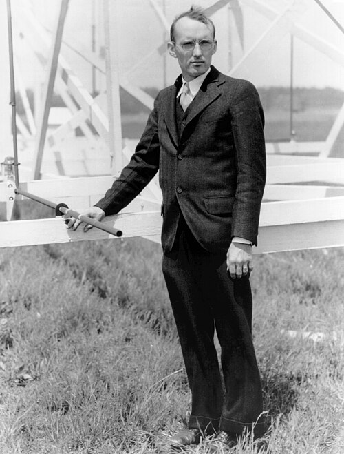

# Karl Jansky

**Born:** 22 October 1905

**Died / status:** 14 February 1950

**Fields:** Radio astronomy, Experimental physics

Sourced portrait or photograph; see the image record for provenance and reuse conditions.

## Biography

An American radio engineer at Bell Laboratories, Jansky identified Galactic radio emission while studying shortwave-communication noise. By recognizing an astronomical origin for apparent interference, he helped establish radio astronomy.

## Major contributions to physics

- Discovered radio emission from the Milky Way.
- Used antenna directionality and sidereal periodicity to identify astronomical signals.
- Established experimental foundations for radio astronomy.

## Image source and rights

- Source: [Original image record](https://commons.wikimedia.org/wiki/File:Jansky-Pose.jpg)
- Creator / attribution: NRAO/AUI/NSF
- License or rights statement: [CC BY 4.0](https://creativecommons.org/licenses/by/4.0)
- Local image: [4ac323fa8e5467a43caa-c7e8fb0357.jpg](../portraits/4ac323fa8e5467a43caa-c7e8fb0357.jpg)
- Credit: https://public.nrao.edu/gallery/karl-guthe-jansky/

## Sources

- [Karl Jansky — institutional or reference biography (maglabweb.magnet.fsu.edu)](https://maglabweb.magnet.fsu.edu/magnet-academy/history-of-electricity-magnetism/pioneers/karl-jansky/)
- [Karl Jansky — institutional or reference biography (en.wikipedia.org)](https://en.wikipedia.org/wiki/Karl_Guthe_Jansky)

Record reviewed: 2026-10-26.
