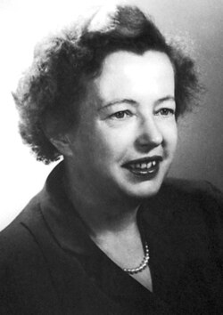

# Maria Goeppert Mayer

**Born:** 28 June 1906

**Died / status:** 20 February 1972

**Fields:** Nuclear physics, Nuclear structure

For the photographer or artist, date and type of image, consult the original image record.

## Biography

Maria Goeppert Mayer was born in Kattowitz, Germany (now Katowice, Poland) and conducted research in nuclear physics and nuclear structure. Nobel records list University of California as the affiliation at the time of the award. They developed a nuclear shell model explaining magic numbers through strong spin-orbit coupling. They were awarded the Nobel Prize in Physics in 1963.

## Major contributions to physics

- Developed a nuclear shell model explaining magic numbers through strong spin-orbit coupling
- Revealed the quantum-shell structure of nucleons in nuclei

**Nobel Prize in Physics:** 1963

## Image source and rights

- Source: [Original image record](https://commons.wikimedia.org/wiki/File:Maria_Goeppert-Mayer.jpg)
- Creator / attribution: Nobel foundation
- License or rights statement: Public domain
- Local image: [1e9d3193aa08170b92fa.jpg](../portraits/1e9d3193aa08170b92fa.jpg)
- Credit: http://nobelprize.org/nobel_prizes/physics/laureates/1963/mayer-autobio.html

## Sources

- [Maria Goeppert Mayer - Facts](https://www.nobelprize.org/prizes/physics/1963/mayer/facts/)
- [Nobel Prize official laureate API, id 79](https://api.nobelprize.org/2.1/laureate/79)
- [Wikipedia: Maria Goeppert-Mayer](https://en.wikipedia.org/wiki/Maria_Goeppert-Mayer)

Record reviewed: 2026-10-26.
