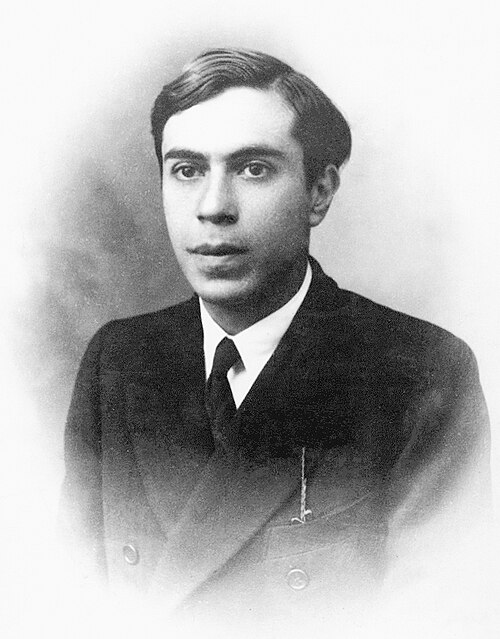

# Ettore Majorana

**Born:** 5 August 1906

**Died / status:** Death date or whereabouts uncertain

**Fields:** Particle physics, Nuclear physics

Sourced photograph or portrait; the image record identifies its creator, provenance, and reuse conditions.

## Biography

An Italian theorist in Fermi's Rome group, Majorana later became a professor at Naples. He disappeared in 1938, and his subsequent life and death remain unresolved. His small body of published work had a lasting influence on particle theory.

## Major contributions to physics

- Developed a description of fermions that can be their own antiparticles.
- Investigated nuclear exchange forces and atomic spectra.
- Developed relativistic wave-equation methods for particles of arbitrary spin.

## Historical and source notes

- Majorana disappeared in 1938. His exact date of death remains unresolved; a null death field does not indicate that he is living.

## Image source and rights

- Source: [Original image record](https://commons.wikimedia.org/wiki/File:Ettore_Majorana.jpg)
- Creator / attribution: Unknown author / Mondadori Collection
- License or rights statement: Public domain
- Local image: [b232afd8e35ff59addc4.jpg](../portraits/b232afd8e35ff59addc4.jpg)
- Credit: [1]

## Sources

- [Ettore Majorana — reference biography (en.wikipedia.org)](https://en.wikipedia.org/wiki/Ettore_Majorana)

Record reviewed: 2026-10-26.
