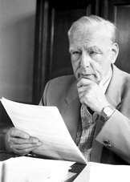

# Ernst Ruska

**Born:** 25 December 1906

**Died / status:** 27 May 1988

**Fields:** Electron optics, Microscopy

For the photographer or artist, date and type of image, consult the original image record.

## Biography

Ernst Ruska was born in Heidelberg, Germany and conducted research in electron optics and microscopy. Nobel records list Fritz-Haber-Institut der Max-Planck-Gesellschaft as the affiliation at the time of the award. They developed electron optics and built early electron microscopes. They were awarded the Nobel Prize in Physics in 1986.

## Major contributions to physics

- Developed electron optics and built early electron microscopes
- Enabled microscopic observations beyond the resolution limits set by visible light

**Nobel Prize in Physics:** 1986

## Image source and rights

- Source: [Original image record](https://en.wikipedia.org/wiki/File:Ernst_Ruska.jpg)
- Creator / attribution: Creator not identified; non-free historical portrait hosted by English Wikipedia
- License or rights statement: Copyrighted or republication permission unverified; consult the original record
- Local image: [239ed424f5fd5aec78f7-86d2379da1.jpg](../portraits/239ed424f5fd5aec78f7-86d2379da1.jpg)
- Credit: Original credit is retained in the source record.
- Republication: permission for use on a public website has not been verified. Confirm permission with the rightsholder or replace the image before publication.

## Sources

- [Ernst Ruska - Facts](https://www.nobelprize.org/prizes/physics/1986/ruska/facts/)
- [Nobel Prize official laureate API, id 127](https://api.nobelprize.org/2.1/laureate/127)
- [Wikipedia: Ernst Ruska](https://en.wikipedia.org/wiki/Ernst_Ruska)

Record reviewed: 2026-10-26.
