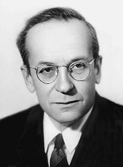

# Vladimir Veksler

**Born:** 4 March 1907

**Died / status:** 22 September 1966

**Fields:** Accelerator physics, Experimental physics

Sourced photograph or portrait; the image record identifies its creator, provenance, and reuse conditions.

## Biography

A Soviet experimental physicist, Veksler studied cosmic rays and particle detection before helping establish the Joint Institute for Nuclear Research in Dubna. His independent discovery of phase stability became a foundation of high-energy synchrotrons.

## Major contributions to physics

- Independently formulated automatic phase stability in accelerators.
- Advanced synchrophasotrons and high-energy experimental facilities.
- Investigated cosmic rays and collective acceleration.

## Image source and rights

- Source: [Original image record](https://en.wikipedia.org/wiki/File:Vladimir_Veksler.jpg)
- Creator / attribution: See the original image record
- License or rights statement: Copyrighted or republication permission unverified; consult the original record
- Local image: [a23303f403e1a00b4b11-15e6e3da42.jpg](../portraits/a23303f403e1a00b4b11-15e6e3da42.jpg)
- Republication: permission for use on a public website has not been verified. Confirm permission with the rightsholder or replace the image before publication.

## Sources

- [Vladimir Veksler — reference biography (en.wikipedia.org)](https://en.wikipedia.org/wiki/Vladimir_Veksler)

Record reviewed: 2026-10-26.
