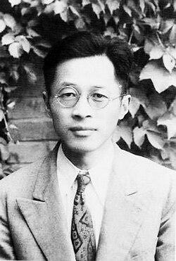

# Wang Ganchang

**Born:** 28 May 1907

**Died / status:** 10 December 1998

**Fields:** Nuclear physics, Particle physics

Sourced photograph or portrait; the image record identifies its creator, provenance, and reuse conditions.

## Biography

Born in Changshu, Jiangsu, Wang graduated from Tsinghua and earned his doctorate in Germany. He worked at Shandong, Zhejiang, and JINR in Dubna before helping build China's nuclear-science and technology programmes.

## Major contributions to physics

- Proposed testing neutrinos through recoil following electron capture.
- Led a team that discovered the antisigma-minus hyperon.
- Contributed to Chinese nuclear testing and laser-driven inertial-confinement-fusion research.

## Image source and rights

- Source: [Original image record](https://commons.wikimedia.org/wiki/File:Wang_Ganchang_early_1950s.jpg)
- Creator / attribution: Unknown author
- License or rights statement: Public domain
- Local image: [05e9db5f430499fcd1db.jpg](../portraits/05e9db5f430499fcd1db.jpg)
- Credit: Public domainPublic domainfalsefalse

## Sources

- [Wang Ganchang — biographical or institutional source (www.caep.ac.cn)](https://www.caep.ac.cn/doc/2020/01/06/499.shtml)
- [Wang Ganchang — reference biography (en.wikipedia.org)](https://en.wikipedia.org/wiki/Wang_Ganchang)

Record reviewed: 2026-10-26.
