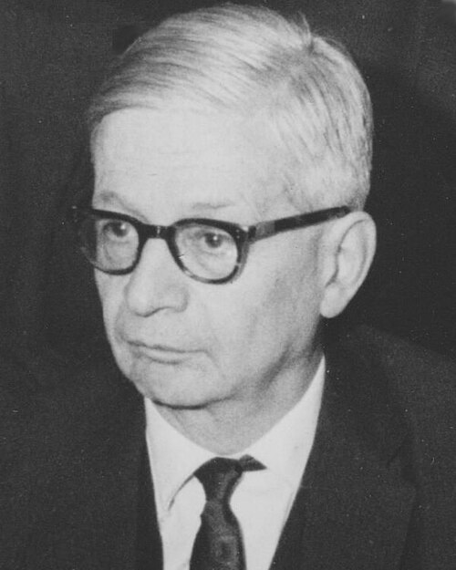

# Rudolf Peierls

**Born:** 5 June 1907

**Died / status:** 19 September 1995

**Fields:** Condensed-matter physics, Nuclear physics

Sourced photograph or portrait; the image record identifies its creator, provenance, and reuse conditions.

## Biography

A German-born theorist who moved to Britain under Nazi persecution, Peierls taught at Birmingham and Oxford. He moved between electronic properties of crystals and nuclear research, later continuing condensed-matter physics and nuclear-policy work.

## Major contributions to physics

- Investigated energy bands, heat conduction, and low-dimensional lattice instability.
- Estimated the scale of a fission weapon's critical mass with Frisch.
- Developed the electron–lattice instability associated with the Peierls transition.

## Image source and rights

- Source: [Original image record](https://commons.wikimedia.org/wiki/File:Peierls,Rudolf_1966_G%C3%B6ttingen.jpg)
- Creator / attribution: GFHund
- License or rights statement: [CC BY 3.0](https://creativecommons.org/licenses/by/3.0)
- Local image: [f28f13db205274fdd9ba.jpg](../portraits/f28f13db205274fdd9ba.jpg)
- Credit: Own work

## Sources

- [Rudolf Peierls — reference biography (en.wikipedia.org)](https://en.wikipedia.org/wiki/Rudolf_Peierls)

Record reviewed: 2026-10-26.
