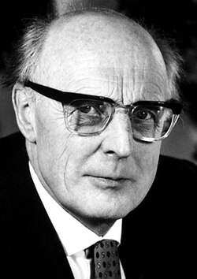

# J. Hans D. Jensen

**Born:** 25 June 1907

**Died / status:** 11 February 1973

**Fields:** Nuclear physics, Nuclear structure

For the photographer or artist, date and type of image, consult the original image record.

## Biography

J. Hans D. Jensen was born in Hamburg, Germany and conducted research in nuclear physics and nuclear structure. Nobel records list University of Heidelberg as the affiliation at the time of the award. They independently developed the nuclear shell model explaining magic numbers. They were awarded the Nobel Prize in Physics in 1963.

## Major contributions to physics

- Independently developed the nuclear shell model explaining magic numbers
- Used spin-orbit coupling to improve the description of nuclear stability

**Nobel Prize in Physics:** 1963

## Image source and rights

- Source: [Original image record](https://commons.wikimedia.org/wiki/File:Johannes_Hans_Daniel_Jensen_(1907%E2%80%931973).jpg)
- Creator / attribution: Nobel foundation
- License or rights statement: Public domain
- Local image: [58ca17d53fb2bc6abd08.jpg](../portraits/58ca17d53fb2bc6abd08.jpg)
- Credit: http://nobelprize.org/nobel_prizes/physics/laureates/1963/jensen-bio.html

## Sources

- [J. Hans D. Jensen - Facts](https://www.nobelprize.org/prizes/physics/1963/jensen/facts/)
- [Nobel Prize official laureate API, id 80](https://api.nobelprize.org/2.1/laureate/80)
- [Wikipedia: J. Hans D. Jensen](https://en.wikipedia.org/wiki/J._Hans_D._Jensen)

Record reviewed: 2026-10-26.
