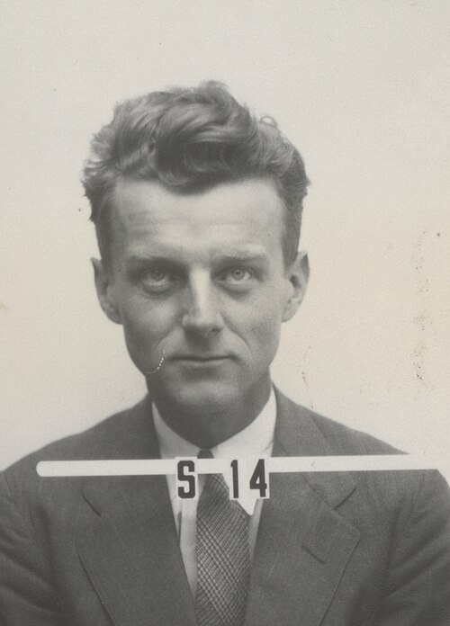

# Seth Neddermeyer

**Born:** 16 September 1907

**Died / status:** 29 January 1988

**Fields:** Cosmic rays, Particle physics, Experimental nuclear physics

Consult the original image record for the creator, date and form of the image.

## Biography

Neddermeyer was an American experimental physicist trained at Caltech. His cosmic-ray research with Carl Anderson contributed to the discovery of the particle later identified as the muon. He subsequently worked on wartime nuclear experiments and continued research and university teaching, linking early particle discoveries with experimental nuclear physics.

## Major contributions to physics

- Co-discovered the muon with Carl Anderson, extending knowledge of the particle content of cosmic rays
- Contributed to experimental nuclear research, associated experimental methods and physics teaching

## Image source and rights

- Source: [Original image record](https://commons.wikimedia.org/wiki/File:Neddermeyer-seth_h.jpg)
- Creator / attribution: Los Alamos National Laboratory
- License or rights statement: Attribution
- Local image: [6496d233b5f1754ab928-4f943d9816.jpg](../portraits/6496d233b5f1754ab928-4f943d9816.jpg)
- Credit: https://about.lanl.gov/history-innovation/badges/

## Sources

- [Atomic Heritage Foundation / Nuclear Museum: Seth Neddermeyer](https://ahf.nuclearmuseum.org/ahf/profile/seth-neddermeyer/)
- [Wikipedia: Seth Neddermeyer](https://en.wikipedia.org/wiki/Seth_Neddermeyer)

Record reviewed: 2026-10-26.
