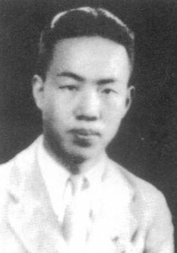

# Zhao Jiuzhang

**Born:** 15 October 1907

**Died / status:** 26 October 1968

**Fields:** Space physics, Geophysics

Sourced photograph or portrait; the image record identifies its creator, provenance, and reuse conditions.

## Biography

Born in Kaifeng, Henan, Zhao studied at Tsinghua and in Berlin before conducting meteorological, geomagnetic, and space-science research in China. He advocated a Chinese satellite programme and helped plan early space investigations.

## Major contributions to physics

- Investigated atmospheric dynamics, geomagnetism, and the space environment.
- Advanced high-altitude sounding and space physics in China.
- Helped develop the scientific case and plans for early Chinese satellites.

## Image source and rights

- Source: [Original image record](https://commons.wikimedia.org/wiki/File:Zhao_jiu_zhang_in_1933.jpg)
- Creator / attribution: Open source picture
- License or rights statement: Public domain
- Local image: [82af4b7f6450cd6bc183.jpg](../portraits/82af4b7f6450cd6bc183.jpg)
- Credit: http://news.sciencenet.cn/html/shownews.aspx?id=192460

## Sources

- [Zhao Jiuzhang — reference biography (en.wikipedia.org)](https://en.wikipedia.org/wiki/Zhao_Jiuzhang)

Record reviewed: 2026-10-26.
