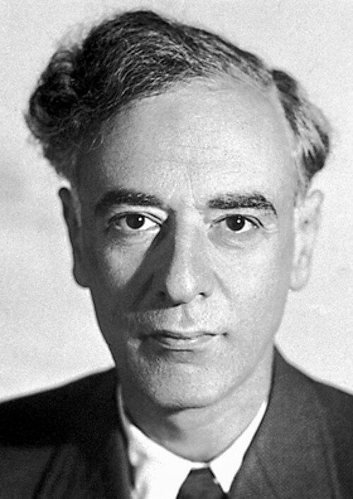

# Lev Davidovich Landau

**Born:** 22 January 1908

**Died / status:** 1 April 1968

**Fields:** Condensed-matter physics, Quantum fluids

For the photographer or artist, date and type of image, consult the original image record.

## Biography

Lev Davidovich Landau was born in Baku, Russian Empire (now Azerbaijan) and conducted research in condensed-matter physics and quantum fluids. Nobel records list Academy of Sciences as the affiliation at the time of the award. They developed the theory of superfluid helium. They were awarded the Nobel Prize in Physics in 1962.

## Major contributions to physics

- Developed the theory of superfluid helium
- Made major contributions to Fermi liquids, phase transitions, plasmas and quantum field theory

**Nobel Prize in Physics:** 1962

## Image source and rights

- Source: [Original image record](https://commons.wikimedia.org/wiki/File:Landau.jpg)
- Creator / attribution: Nobel foundation
- License or rights statement: Public domain
- Local image: [952af5d117278acbf8db.jpg](../portraits/952af5d117278acbf8db.jpg)
- Credit: http://nobelprize.org/nobel_prizes/physics/laureates/1962/landau-bio.html

## Sources

- [Lev Landau - Facts](https://www.nobelprize.org/prizes/physics/1962/landau/facts/)
- [Nobel Prize official laureate API, id 77](https://api.nobelprize.org/2.1/laureate/77)
- [Wikipedia: Lev Landau](https://en.wikipedia.org/wiki/Lev_Landau)

Record reviewed: 2026-10-26.
