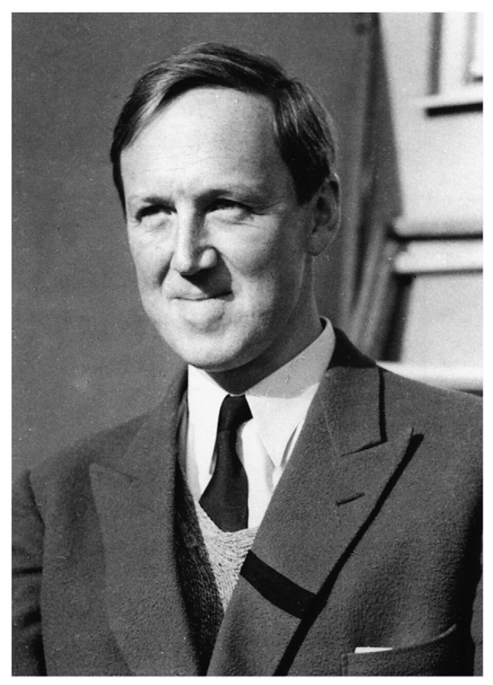

# Hannes Olof Gösta Alfvén

**Born:** 30 May 1908

**Died / status:** 2 April 1995

**Fields:** Plasma physics, Space physics

For the photographer or artist, date and type of image, consult the original image record.

## Biography

Hannes Olof Gösta Alfvén was born in Norrköping, Sweden and conducted research in plasma physics and space physics. Nobel records list Royal Institute of Technology as the affiliation at the time of the award. They developed magnetohydrodynamics and predicted Alfvén waves. They were awarded the Nobel Prize in Physics in 1970.

## Major contributions to physics

- Developed magnetohydrodynamics and predicted Alfvén waves
- Applied plasma theory to phenomena in space and astrophysics

**Nobel Prize in Physics:** 1970

## Image source and rights

- Source: [Original image record](https://commons.wikimedia.org/wiki/File:YoungAlfven.jpg)
- Creator / attribution: Unknown author
- License or rights statement: Public domain
- Local image: [7c33e96da1ec0fb0c572.jpg](../portraits/7c33e96da1ec0fb0c572.jpg)
- Credit: http://www-lgit.obs.ujf-grenoble.fr/users/talbouss/public_html/RECHERCHE/WebAlfven/images/youngAlfven.jpg

## Sources

- [Hannes Alfvén - Facts](https://www.nobelprize.org/prizes/physics/1970/alfven/facts/)
- [Nobel Prize official laureate API, id 91](https://api.nobelprize.org/2.1/laureate/91)
- [Wikipedia: Hannes Alfvén](https://en.wikipedia.org/wiki/Hannes_Alfv%C3%A9n)

Record reviewed: 2026-10-26.
