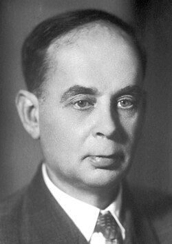

# Il´ja Mikhailovich Frank

**Born:** 23 October 1908

**Died / status:** 22 June 1990

**Fields:** Radiation physics, Nuclear physics

For the photographer or artist, date and type of image, consult the original image record.

## Biography

Il´ja Mikhailovich Frank was born in Leningrad (now St. Petersburg), Russia and conducted research in radiation physics and nuclear physics. Nobel records list Lomonosov Moscow State University and P.N. Lebedev Physical Institute as the affiliations at the time of the award. They explained the conditions and properties of Cherenkov radiation with Igor Tamm. They were awarded the Nobel Prize in Physics in 1958.

## Major contributions to physics

- Explained the conditions and properties of Cherenkov radiation with Igor Tamm
- Advanced the use of the phenomenon in experimental physics

**Nobel Prize in Physics:** 1958

## Image source and rights

- Source: [Original image record](https://commons.wikimedia.org/wiki/File:Ilya_Frank.jpg)
- Creator / attribution: Nobel foundation
- License or rights statement: Public domain
- Local image: [7984bd8330375015f3c2.jpg](../portraits/7984bd8330375015f3c2.jpg)
- Credit: http://nobelprize.org/nobel_prizes/physics/laureates/1958/frank-bio.html

## Sources

- [Il´ja M. Frank - Facts](https://www.nobelprize.org/prizes/physics/1958/frank/facts/)
- [Nobel Prize official laureate API, id 721](https://api.nobelprize.org/2.1/laureate/721)
- [Wikipedia: Ilya Frank](https://en.wikipedia.org/wiki/Ilya_Frank)

Record reviewed: 2026-10-26.
