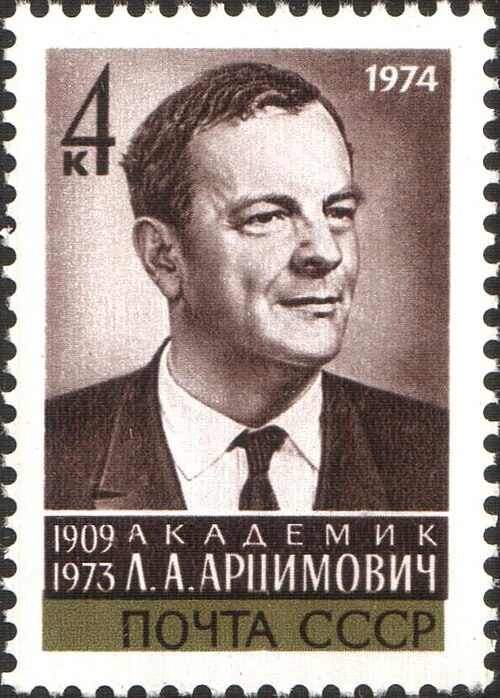

# Lev Artsimovich

**Born:** 25 February 1909

**Died / status:** 1 March 1973

**Fields:** Plasma physics, Nuclear fusion

Sourced photograph or portrait; the image record identifies its creator, provenance, and reuse conditions.

## Biography

A Soviet experimental physicist at the Kurchatov research organization, Artsimovich led controlled-fusion research. His development of tokamak experiments and diagnostic methods helped establish the promise of magnetic plasma confinement.

## Major contributions to physics

- Led tokamak and controlled-fusion experiments.
- Advanced high-temperature plasma confinement and diagnostics.
- Investigated gas discharges and atomic and nuclear experimental physics.

## Image source and rights

- Source: [Original image record](https://commons.wikimedia.org/wiki/File:1974_CPA_4316.jpg)
- Creator / attribution: USSR Post
- License or rights statement: Public domain
- Local image: [95659549d5f4ba7d9da6.jpg](../portraits/95659549d5f4ba7d9da6.jpg)
- Credit: Scanned 600 dpi by User Matsievsky from personal collection

## Sources

- [Lev Artsimovich — reference biography (en.wikipedia.org)](https://en.wikipedia.org/wiki/Lev_Artsimovich)

Record reviewed: 2026-10-26.
