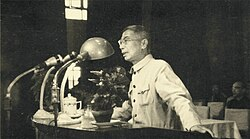

# Guo Yonghuai

**Born:** 4 April 1909

**Died / status:** 5 December 1968

**Fields:** Fluid mechanics, Explosion mechanics

Sourced photograph or portrait; the image record identifies its creator, provenance, and reuse conditions.

## Biography

Born in Rongcheng, Shandong, Guo studied in Canada and the United States, working with von Kármán at Caltech. After returning to China in 1956, he helped establish mechanics and nuclear-weapons research. He died in an aircraft accident in 1968.

## Major contributions to physics

- Investigated transonic and high-speed gas dynamics.
- Developed asymptotic methods for flow problems.
- Contributed to explosion and fluid-mechanical research in China's nuclear programme.

## Image source and rights

- Source: [Original image record](https://commons.wikimedia.org/wiki/File:%E9%83%AD%E6%B0%B8%E6%87%B7.jpg)
- Creator / attribution: Unknown author
- License or rights statement: Public domain
- Local image: [64ee001cd5f211c850f8.jpg](../portraits/64ee001cd5f211c850f8.jpg)
- Credit: http://lswhw.ustc.edu.cn/index.php/index/info/640

## Sources

- [Guo Yonghuai — biographical or institutional source (imech.cas.cn)](https://imech.cas.cn/people/na/202302/t20230227_6684134.html)
- [Guo Yonghuai — reference biography (en.wikipedia.org)](https://en.wikipedia.org/wiki/Guo_Yonghuai)

Record reviewed: 2026-10-26.
