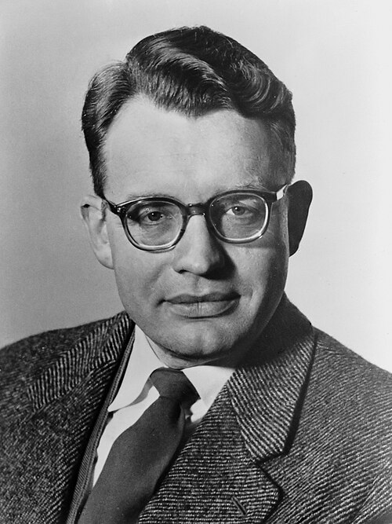

# Hendrik Casimir

**Born:** 15 July 1909

**Died / status:** 4 May 2000

**Fields:** Quantum electrodynamics, Condensed-matter physics, Superconductivity

Consult the original image record for the creator, date and form of the image.

## Biography

Casimir was a Dutch theoretical physicist trained with Ehrenfest who worked in Leiden and later helped direct research at Philips. He investigated nuclear magnetic moments, superconductivity and electromagnetic fluctuations, connecting quantum theory with industrial research. He is particularly known for the predicted force associated with quantum vacuum fluctuations.

## Major contributions to physics

- Predicted the Casimir force between ideal conducting boundaries arising from electromagnetic quantum fluctuations
- Investigated retarded dispersion interactions with Polder, now called Casimir–Polder interactions
- Studied superconducting thermodynamics and two-fluid descriptions with Gorter and others

## Image source and rights

- Source: [Original image record](https://commons.wikimedia.org/wiki/File:Hendrik_Casimir_(1958).jpg)
- Creator / attribution: Anefo
- License or rights statement: [CC BY-SA 3.0](https://creativecommons.org/licenses/by-sa/3.0)
- Local image: [9758ea4326098c86b627-f8947aec8f.jpg](../portraits/9758ea4326098c86b627-f8947aec8f.jpg)
- Credit: Edited version of Nationaal Archief

## Sources

- [D. Polder: KNAW memorial for Hendrik Brugt Gerhard Casimir](https://dwc.knaw.nl/DL/levensberichten/PE00004564.pdf)
- [Wikipedia: Hendrik Casimir](https://en.wikipedia.org/wiki/Hendrik_Casimir)

Record reviewed: 2026-10-26.
