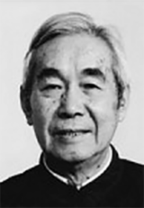

# Zhang Wenyu

**Born:** 9 January 1910

**Died / status:** 5 November 1992

**Fields:** Cosmic rays, Particle physics

Sourced photograph or portrait; the image record identifies its creator, provenance, and reuse conditions.

## Biography

Born in Hui'an, Fujian, Zhang conducted research at Cambridge and American universities before returning to China in 1956. He led Chinese cosmic-ray and high-energy experiments and helped establish the Institute of High Energy Physics.

## Major contributions to physics

- Experimentally established capture of negative muons by atoms, advancing muonic-atom research.
- Conducted cosmic-ray and elementary-particle experiments.
- Built high-energy experimental facilities and research teams in China.

## Image source and rights

- Source: [Original image record](https://www.ihep.cas.cn/kydw/yszj/ygys/202210/t20221010_6521764.html)
- Creator / attribution: Photographer not identified
- License or rights statement: Copyrighted or republication permission unverified; consult the original record
- Local image: [d785716f74f8335ab846-803b719447.png](../portraits/d785716f74f8335ab846-803b719447.png)
- Credit: Original credit is retained in the source record.
- Republication: permission for use on a public website has not been verified. Confirm permission with the rightsholder or replace the image before publication.

## Sources

- [Zhang Wenyu — biographical or institutional source (ihep.cas.cn)](https://ihep.cas.cn/kxcb/kxrw/zhangwenyu/200909/t20090922_2514309.html)
- [Zhang Wenyu — reference biography (en.wikipedia.org)](https://en.wikipedia.org/wiki/Zhang_Wenyu)

Record reviewed: 2026-10-26.
