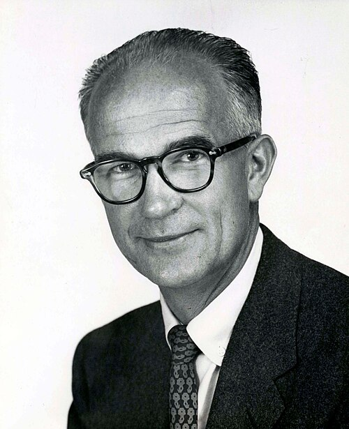

# William Bradford Shockley

**Born:** 13 February 1910

**Died / status:** 12 August 1989

**Fields:** Semiconductor physics, Electronic devices

For the photographer or artist, date and type of image, consult the original image record.

## Biography

William Bradford Shockley was born in London, United Kingdom and conducted research in semiconductor physics and electronic devices. Nobel records list Semiconductor Laboratory of Beckman Instruments, Inc. as the affiliation at the time of the award. They investigated semiconductors and contributed to the invention of the transistor. They were awarded the Nobel Prize in Physics in 1956.

## Major contributions to physics

- Investigated semiconductors and contributed to the invention of the transistor
- Established important foundations of solid-state electronics and microelectronics

**Nobel Prize in Physics:** 1956

## Image source and rights

- Source: [Original image record](https://commons.wikimedia.org/wiki/File:Shockley.jpg)
- Creator / attribution: Nobel foundation
- License or rights statement: Public domain
- Local image: [73420dec5d52b43c1382.jpg](../portraits/73420dec5d52b43c1382.jpg)
- Credit: https://nobelprize.org/nobel_prizes/physics/laureates/1956/shockley-bio.html

## Sources

- [William B. Shockley - Facts](https://www.nobelprize.org/prizes/physics/1956/shockley/facts/)
- [Nobel Prize official laureate API, id 65](https://api.nobelprize.org/2.1/laureate/65)
- [Wikipedia: William Shockley](https://en.wikipedia.org/wiki/William_Shockley)

Record reviewed: 2026-10-26.
